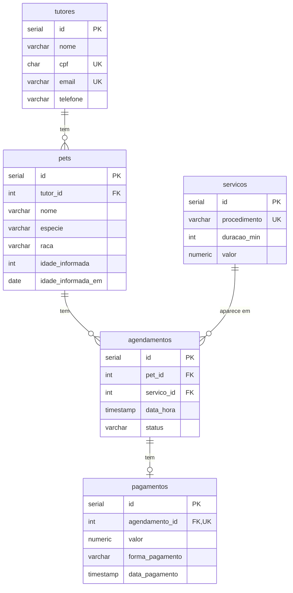

# Petshop — Atividade Final de Banco de Dados II

Aplicação de terminal para um petshop: cadastro de tutores e pets, catálogo de serviços, agendamentos, pagamentos e prontuário de atendimentos.

> O enunciado do trabalho está em [ENUNCIADO.md](ENUNCIADO.md).

## Integrantes

- _Derek Formentin de Oliveira_
- _Hope Borba Lemes_
- _Luiz Theodoro Sartori de Freitas_
- _Roberto Nunes Ferreira_

## Tecnologias

| Item | Escolha |
|---|---|
| Linguagem | Python 3.10+ |
| Banco relacional | PostgreSQL 17 |
| Banco não relacional | MongoDB 8 |
| Ambiente dos bancos | Docker Compose |

## Como executar

**Pré-requisitos:** [Python](https://www.python.org/downloads/) 3.10+ e [Docker](https://docs.docker.com/get-docker/).

```bash
cd bd2
python -m venv .venv                 # cria o ambiente virtual (só na primeira vez)
source .venv/bin/activate            # Linux/macOS  |  Windows: .venv\Scripts\activate
pip install -r requirements.txt      # instala as dependências
cp .env.example .env                 # cria o arquivo de configuração
docker compose up -d                 # sobe o PostgreSQL e o MongoDB
python main.py                       # abre o menu da aplicação
```

Bibliotecas usadas (em `requirements.txt`): `psycopg` (PostgreSQL), `pymongo` (MongoDB), `python-dotenv` (lê o `.env`) e `tabulate` (mostra tabelas no terminal).

Na primeira vez que os bancos sobem, os scripts da pasta `database/` rodam sozinhos e criam as tabelas, a coleção, a validação, o índice e os dados de exemplo. Não é preciso instalar `psql` nem `mongosh`.

| Comando | O que faz |
|---|---|
| `docker compose up -d` | Sobe os dois bancos |
| `docker compose down` | Desliga os bancos (os dados continuam salvos) |
| `docker compose down -v && docker compose up -d` | **Apaga tudo** e recria os bancos do zero com os scripts |

> Alterou o `postgres.sql` ou o `mongo.js`? Recrie os bancos com o último comando acima: os scripts só rodam quando o banco está vazio.

### Rodar os scripts manualmente

Os dois scripts apagam e recriam tudo o que criam, então podem ser rodados de novo quantas vezes for preciso.

**No Docker** (sem apagar os containers):

```bash
docker exec -i petshop-postgres psql -U petshop -d petshop < database/postgres.sql
docker exec petshop-mongo mongosh --quiet petshop /docker-entrypoint-initdb.d/mongo.js
```

**Sem Docker** (PostgreSQL e MongoDB instalados na máquina):

```bash
createdb petshop                              # só na primeira vez
psql -d petshop -f database/postgres.sql
mongosh petshop database/mongo.js
```

Se o seu PostgreSQL pedir usuário e senha, use `psql -U seu_usuario -d petshop -f database/postgres.sql`.

Depois ajuste o `.env` para as portas padrão e o seu usuário do PostgreSQL:

```env
PG_HOST=localhost
PG_PORT=5432
PG_USER=seu_usuario
PG_PASSWORD=sua_senha
MONGO_URL=mongodb://localhost:27017
```

> No Linux, se você entra no `psql` sem senha, use `PG_HOST=/run/postgresql` e deixe `PG_PASSWORD` vazio.

### Acessar os bancos direto (para a apresentação)

```bash
docker exec -it petshop-postgres psql -U petshop -d petshop
docker exec -it petshop-mongo mongosh petshop
```

As portas no computador são **5433** (PostgreSQL) e **27018** (MongoDB), para não conflitar com bancos já instalados na máquina.

## Estrutura do projeto

```text
bd2/
├── database/
│   ├── postgres.sql      # tabelas, chaves, CHECKs, dados de exemplo e JOIN
│   └── mongo.js          # coleção, validação $jsonSchema, índice e exemplos (roda no mongosh)
├── app/
│   ├── config/           # conexões com PostgreSQL e MongoDB
│   ├── menus/            # submenus do terminal (um por tabela/coleção)
│   ├── repositories/     # consultas de cada tabela/coleção (CRUD)
│   ├── utils/            # leitura do teclado, tabelas e tradução de erros
│   └── services/
│       └── ficha_pet_service.py   # integração entre os dois bancos
├── main.py               # menu principal (ponto de entrada)
├── requirements.txt      # dependências Python
├── docker-compose.yml
└── .env.example
```

## Banco relacional (PostgreSQL)

Modelo ER:



Decisões do modelo:

- **A chave estrangeira fica no lado "muitos"**: um tutor tem vários pets, então `tutor_id` fica em `pets`.
- **`servicos` é um catálogo** (banho, tosa, consulta). Quem liga pet e serviço é o agendamento.
- **Cada agendamento tem no máximo um pagamento**, por isso `agendamento_id` é `UNIQUE` em `pagamentos`.
- **Idade do pet**: muitos tutores não sabem a data de nascimento, então guardamos a idade que o tutor informou (`idade_informada`) e a data em que ela foi informada (`idade_informada_em`). A idade atual é calculada na consulta, somando os anos que passaram desde então: um pet cadastrado com 3 anos aparece com 4 um ano depois, sem ninguém atualizar nada.
- **Dinheiro usa `NUMERIC(10,2)`**, nunca `FLOAT`, para não ter erro de arredondamento.
- **`CHECK`** limita `status` a agendado/concluido/cancelado, `forma_pagamento` a dinheiro/pix/cartao, o CPF a 11 dígitos e a idade a 0–40 anos.

Consultas com JOIN:

- **Agenda do dia** (menu Agendamentos → opção 6): junta `agendamentos`, `pets`, `tutores` e `servicos` para mostrar, em ordem de horário, o pet, o tutor com telefone, o serviço, a duração e o preço. Está em `agenda_do_dia()` no [agendamento_repository.py](app/repositories/agendamento_repository.py).
- **Pagamentos do mês** (menu Pagamentos → opção 7): junta as 5 tabelas para listar os pagamentos do mês atual com tutor, pet e serviço, e mostra o total recebido. Está em `do_mes()` no [pagamento_repository.py](app/repositories/pagamento_repository.py) e também no final do [postgres.sql](database/postgres.sql).
- **Concluídos sem pagamento** (menu Pagamentos → opção 6): `LEFT JOIN` entre `agendamentos` e `pagamentos` com `WHERE pg.id IS NULL`, para achar os atendimentos feitos que ainda não foram pagos. Está em `pendentes()` no mesmo arquivo.

Regras dos pagamentos:

- **Só agendamentos concluídos podem ser pagos.** Essa regra fica na aplicação, porque depende do status de outra tabela.
- **Cada agendamento só pode ser pago uma vez.** Quem garante é o banco, com o `UNIQUE` em `agendamento_id`. A aplicação não confere antes, de propósito, para mostrar o banco recusando.
- **O valor sugerido é o preço do serviço**, mas pode ser alterado (um desconto, por exemplo). Ele fica gravado no pagamento: se o preço do serviço mudar depois, o que foi pago não muda.

## Banco não relacional (MongoDB)

Coleção **`atendimentos`**: a ficha (prontuário) de cada atendimento do pet.

| Campo | Regra |
|---|---|
| `pet_id` | obrigatório; é o `id` do pet no PostgreSQL |
| `data` | obrigatório; data do atendimento |
| `tipo` | obrigatório; `enum`: banho, tosa, consulta ou vacina |
| `peso_kg` | número entre 0.1 e 150 (`minimum` / `maximum`) |
| `microchip` | `pattern` (regex): exatamente 15 dígitos |
| `vacinas` | lista de `{ nome, lote }` |
| `observacoes` | texto com `maxLength` |

**Índice em `pet_id`**: a busca mais comum é "o histórico deste pet", e é por esse campo que a aplicação liga o MongoDB ao PostgreSQL. Sem o índice, o MongoDB teria que ler a coleção inteira a cada consulta.

**Quem valida é o MongoDB, não a aplicação.** O app monta o documento com o que foi digitado e manda para o banco. Se algo quebrar o `$jsonSchema`, o MongoDB recusa (erro 121), e o app lista cada regra quebrada em português. Um peso digitado como texto, por exemplo, é enviado como texto, de propósito, para o `bsonType` recusar.

**O MongoDB não tem chave estrangeira.** Por isso, antes de inserir, a aplicação confere no PostgreSQL se o `pet_id` existe.

O menu **Atendimentos (MongoDB)** tem, além do CRUD, três opções feitas para a apresentação:

| Opção | O que mostra |
|---|---|
| 7 - Testar documento inválido | Tenta inserir um documento que quebra 6 regras: `pet_id` como texto (`bsonType`), `tipo` fora do `enum`, peso acima do `maximum`, microchip fora do `pattern`, vacina sem `lote` e `data` ausente (`required`) |
| 8 - Ver regras de validação | O `$jsonSchema` que está gravado na coleção |
| 9 - Ver índice e plano da busca | Os índices da coleção e o `explain` da busca por `pet_id`, com o índice (`IXSCAN`, lê só os documentos do pet) e sem ele (`COLLSCAN`, lê a coleção inteira) |

## Integração entre os bancos

A opção **Ficha completa do pet** junta os dois bancos usando o `pet_id`:

```text
PostgreSQL                          MongoDB
pet, tutor, agendamentos,     +     histórico de atendimentos,
total pago                          última vacina, peso atual
                 \                 /
                  ficha completa do pet
```

A lógica está em [ficha_pet_service.py](app/services/ficha_pet_service.py), em quatro passos:

1. **PostgreSQL:** busca o pet e o tutor.
2. **PostgreSQL:** busca os agendamentos do pet com o pagamento de cada um (`LEFT JOIN`). Daí saem o total pago e o próximo agendamento.
3. **MongoDB:** busca o histórico de atendimentos do pet, usando o índice em `pet_id`. Daí saem o peso atual, o microchip e a última vacina.
4. **Cruzamento:** procura agendamentos concluídos no PostgreSQL que não têm ficha no MongoDB do mesmo dia e do mesmo tipo, ou seja, atendimentos feitos que ninguém registrou no prontuário.

Nenhum dos dois bancos consegue montar essa ficha sozinho: o PostgreSQL não tem o prontuário, e o MongoDB não sabe quem é o tutor nem quanto foi pago.

## Por que cada dado está em cada banco

**No PostgreSQL** ficam os dados com estrutura fixa e muitas ligações entre si: tutores, pets, serviços, agendamentos e pagamentos. Esses dados precisam de chaves estrangeiras (um agendamento não pode apontar para um pet que não existe), de regras rígidas (`CHECK`, `UNIQUE`) e de consultas que cruzam várias tabelas com `JOIN`. Isso vale principalmente para o dinheiro.

**No MongoDB** ficam os atendimentos, porque cada ficha tem um formato diferente: uma consulta registra peso e observações, uma vacina registra uma lista de vacinas com lote, um banho quase não tem informação extra. Em uma tabela isso viraria muitas colunas vazias ou tabelas extras. No MongoDB cada documento guarda só o que aquele atendimento tem, e o `$jsonSchema` ainda garante os campos obrigatórios e os formatos.
